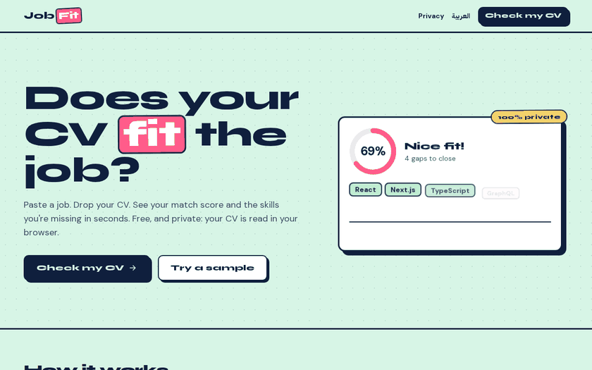

# JobFit

**Does your CV fit the job?** Paste a job post, drop your CV, and see your match score and missing skills in seconds. Sign in for AI-rewritten CV bullets, a cover letter and interview prep — with your personal details hidden before anything reaches the AI.

Free to use, free to run, and private by design.



## What makes it different

- **Runs in your browser.** The PDF is read with pdf.js on the user's device; skill matching happens in the page. No upload.
- **Personal data is masked before the AI.** Name, email, phone, address, links and ID numbers (CNIC, Emirates ID, passport) become tags like `[EMAIL-1]`. Users see exactly what is sent, can click any word to hide it too, and get the real values back on their own screen only. The server rejects any request that still contains an email, phone or link.
- **Any AI, by configuration.** One adapter (Vercel AI SDK) picks Gemini, Groq, OpenAI, Anthropic or a local Ollama from env vars.
- **Verified users only.** AI routes check the Auth.js session (Google or GitHub) on the server, then a per-user daily limit in Upstash Redis.
- **Nothing stored.** No database of CVs or results. The only server state is a daily run counter per user.
- **A real UI library.** Design tokens live once in `app/globals.css`; every screen is built from `components/ui`, browsable at `/design`. Lint rules enforce it (see `AGENTS.md`).
- English and Arabic (RTL).

## Stack

Next.js 16 (App Router) · TypeScript · Tailwind CSS 4 · Vercel AI SDK 7 · Auth.js v5 · Upstash Redis · pdf.js · next-intl · Vitest · Playwright

## Run it locally

```bash
npm install
cp .env.example .env.local   # then fill it in (see below)
npm run dev
```

Without any AI key you can still use the match score and the "Try a sample" demo. Without Upstash, local dev uses an in-memory counter.

```bash
npm test           # unit tests: masking, matching, limits, AI route auth
npm run check      # types, lint (incl. UI rules), formatting, UI registry
npm run test:e2e   # Playwright smoke tests (on demand)
```

## Environment variables

| Name                                                                                     | What it is                                                                                                                                                          |
| ---------------------------------------------------------------------------------------- | ------------------------------------------------------------------------------------------------------------------------------------------------------------------- |
| `AUTH_SECRET`                                                                            | Random secret for Auth.js. Generate with `npx auth secret`.                                                                                                         |
| `AUTH_GOOGLE_ID`, `AUTH_GOOGLE_SECRET`                                                   | Google OAuth client.                                                                                                                                                |
| `AUTH_GITHUB_ID`, `AUTH_GITHUB_SECRET`                                                   | GitHub OAuth app.                                                                                                                                                   |
| `AI_PROVIDER`                                                                            | `google`, `groq`, `openai`, `anthropic` or `ollama`.                                                                                                                |
| `AI_MODEL`                                                                               | Model id for that provider, e.g. `gemini-3.5-flash-lite`.                                                                                                           |
| `GOOGLE_GENERATIVE_AI_API_KEY` / `GROQ_API_KEY` / `OPENAI_API_KEY` / `ANTHROPIC_API_KEY` | Only the one for your provider.                                                                                                                                     |
| `OLLAMA_BASE_URL`                                                                        | For a local Ollama, e.g. `http://localhost:11434/api`.                                                                                                              |
| `AI_DAILY_LIMIT`                                                                         | AI runs per user per UTC day (default 5).                                                                                                                           |
| `UPSTASH_REDIS_REST_URL`, `UPSTASH_REDIS_REST_TOKEN`                                     | Upstash Redis REST credentials. Required in production. The Vercel Marketplace integration names them `KV_REST_API_URL` and `KV_REST_API_TOKEN`; either pair works. |

Keys are read on the server only. Nothing secret uses the `NEXT_PUBLIC_` prefix.

### Switching the AI

Change two env vars and redeploy — no code change:

| Provider      | `AI_PROVIDER` | Example `AI_MODEL`      | Free tier (checked Nov 2026)                   |
| ------------- | ------------- | ----------------------- | ---------------------------------------------- |
| Google Gemini | `google`      | `gemini-3.5-flash-lite` | ~500 requests/day on Flash-Lite; Flash ~20/day |
| Groq          | `groq`        | `openai/gpt-oss-120b`   | ~1,000 requests/day, 8K tokens/minute          |
| OpenAI        | `openai`      | any chat model          | paid                                           |
| Anthropic     | `anthropic`   | any Claude model        | paid                                           |
| Ollama        | `ollama`      | `llama3.2`              | free, runs on your machine                     |

Free-tier limits change often; the provider's console shows your real quota.

## Setting up the free accounts

1. **Gemini key** — go to [aistudio.google.com/apikey](https://aistudio.google.com/apikey), create a key, set `GOOGLE_GENERATIVE_AI_API_KEY`.
2. **Google sign-in** — in [Google Cloud console](https://console.cloud.google.com): create a project → _APIs & Services → OAuth consent screen_ (External, app name "JobFit", your email) → _Credentials → Create OAuth client ID → Web application_. Authorised redirect URIs:
   - `http://localhost:3080/api/auth/callback/google`
   - `https://<your-domain>/api/auth/callback/google`
3. **GitHub sign-in** — [github.com/settings/developers](https://github.com/settings/developers) → _New OAuth App_. Homepage `https://<your-domain>`, callback `https://<your-domain>/api/auth/callback/github`. (A GitHub OAuth app has one callback, so make a second one for `http://localhost:3080` if you want GitHub sign-in locally.)
4. **Upstash Redis** — [console.upstash.com](https://console.upstash.com) → _Create database_ (free) → copy the REST URL and token. Or add it from the Vercel Marketplace, which sets the env vars for you.
5. **Vercel** — import the GitHub repo, add the env vars above for Production, deploy.

## Project map

```
app/[locale]/          pages: landing, /check, /privacy, /design
app/api/ai/[tool]/     the one AI route: session → validate → daily limit → stream
components/ui/         the UI library (registry.ts lists every component)
components/check/      the check flow, AI tools, mask preview
lib/privacy/mask.ts    masking and unmasking (browser) + server check
lib/match/             skill dictionary and scoring
lib/pdf/               pdf.js text extraction
lib/ai/                provider adapter and prompts
lib/limits/daily.ts    per-user daily counter
```

## Licence

MIT
